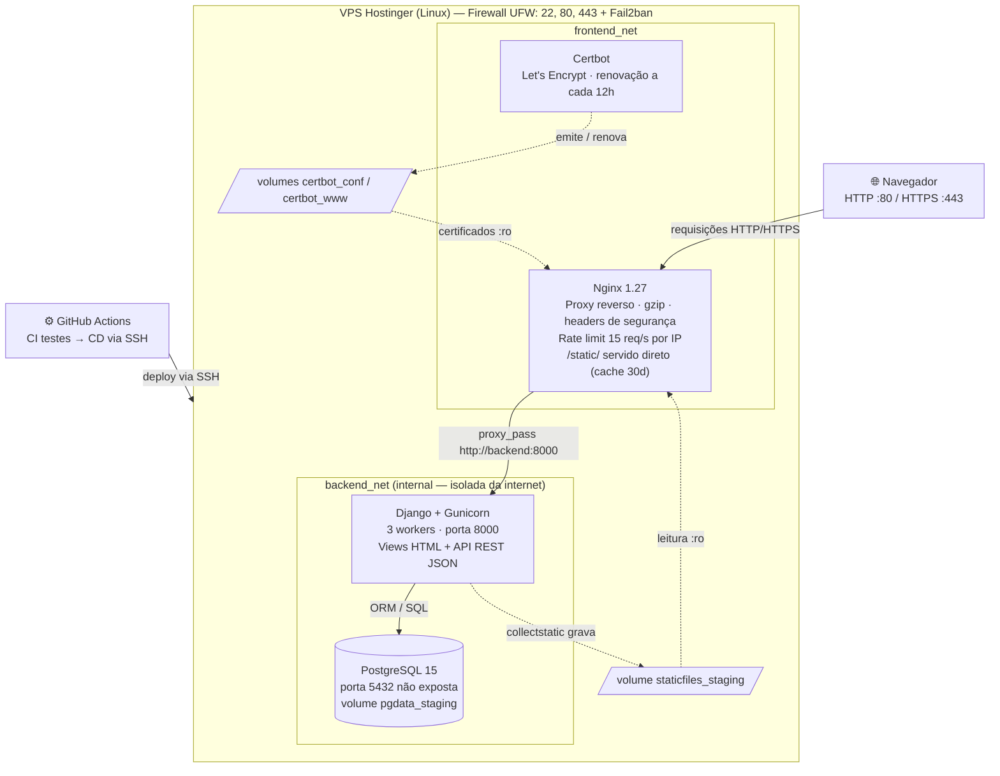
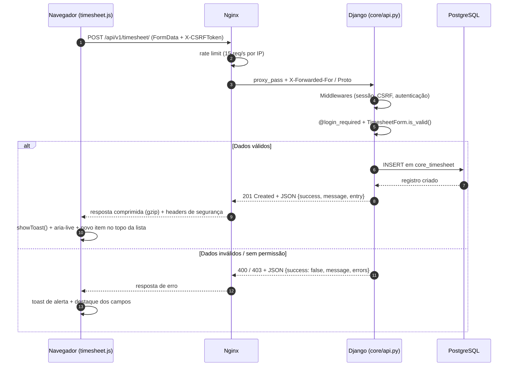
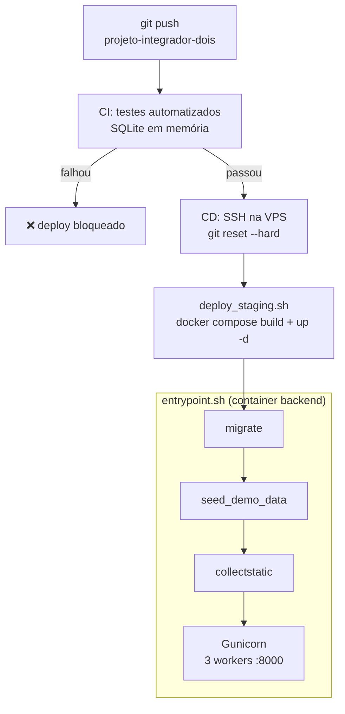

# FCN TI | Plataforma de Gestão Integrada

> **Projeto Integrador em Computação II (PJI240) — UNIVESP**  
> Engenharia de Software e Arquitetura em Nuvem na Otimização de Processos de Negócio  
> Polo Parque de Inovação Tecnológica — São José dos Campos/SP (2026)

Este repositório contém a evolução da plataforma corporativa da **FCN TI**, desenhada para substituir controles descentralizados em planilhas por uma solução robusta para gestão de contratos, alocação de equipe técnica, apontamento de horas (*timesheet*) e auditoria financeira (*billability* e *burn rate*).

---

## 📌 Organização de Branches do Repositório

Para preservar o histórico acadêmico e as entregas da faculdade, mantemos duas branches principais:

* **`main`**: Código congelado e homologado referente ao **Projeto Integrador 1**.
* **`projeto-integrador-dois`** *(Atual)*: Branch ativa onde reside a evolução completa do **Projeto Integrador 2** (Nuvem, APIs REST, JavaScript Assíncrono, Acessibilidade WCAG e Testes Automatizados).

---

## 🚀 O Delta de Evolução: O que mudou do PI 1 para o PI 2?

O Projeto Integrador 2 representa o salto de um protótipo estático monolítico para uma **plataforma distribuída em nuvem, acessível e dinâmica**:

| Dimensão | Projeto Integrador 1 (`main`) | Projeto Integrador 2 (`projeto-integrador-dois`) |
| :--- | :--- | :--- |
| **Infraestrutura & Nuvem** | Hospedagem tradicional com quedas e porta de banco exposta | Deploy em nuvem (Hostinger VPS), Nginx como proxy reverso, Gunicorn e banco blindado |
| **Interatividade de Interface** | Recarregamento total da tela a cada formulário enviado (*síncrono*) | **JavaScript Assíncrono (`fetch`)**: dados salvos em segundo plano com feedback visual instantâneo |
| **Acessibilidade Universal** | Interface padrão sem conformidade assistiva | **WCAG 2.1 AA**: atalho *Skip Link*, suporte a leitores de tela e navegação 100% por teclado |
| **Arquitetura de Dados** | Backend retornava exclusivamente HTML | **APIs REST (JSON)** para integração com frontend dinâmico e serviços externos |
| **Garantia de Qualidade** | Testes manuais pontuais | Suíte de **testes automatizados de API e regressão** com pipeline de **CI/CD (GitHub Actions)** |
| **Gestão de Dependências** | `requirements.txt` básico | **Poetry** com trava de versões criptográfica (`poetry.lock`) e separação produção/dev |

---

## 💻 Guia Rápido para a Equipe: Como Rodar Localmente

Qualquer membro do grupo (seja da área técnica ou de negócios) consegue rodar a aplicação completa na sua máquina usando apenas o **Docker Desktop**.

### Passo 1. Garantir que está na branch correta
No seu terminal (ou Git Bash / VS Code):
```bash
git checkout projeto-integrador-dois
git pull origin projeto-integrador-dois
```

### Passo 2. Criar o arquivo de configuração
Basta copiar o arquivo de exemplo (no Windows PowerShell ou CMD):
```powershell
Copy-Item .env.example .env
```
*(No Linux ou Mac: `cp .env.example .env`)*

### Passo 3. Iniciar o sistema
```bash
docker compose up --build
```

> 💡 **Dica de Desenvolvimento (Live-Reload):**  
> O container local está sincronizado com a sua pasta de arquivos (`./backend:/app`). Isso significa que qualquer alteração que você fizer no código ou nos textos das telas é atualizada **na hora**, sem precisar reiniciar o Docker!

Quando o terminal indicar que o servidor subiu, basta acessar pelo navegador:
* 🌐 **Aplicação Web:** [http://localhost:8000/](http://localhost:8000/)
* 📊 **Dashboard:** [http://localhost:8000/dashboard/](http://localhost:8000/dashboard/)
* ⏱️ **Registro de Horas:** [http://localhost:8000/timesheet/](http://localhost:8000/timesheet/)
* ⚙️ **Painel Administrativo:** [http://localhost:8000/admin/](http://localhost:8000/admin/)

Para parar a aplicação, pressione `Ctrl + C` no terminal ou execute em outra janela:
```bash
docker compose down
```

---

## 🧪 Roteiro de Testes para o Time Validar as Novidades

Se você for testar a aplicação para a apresentação ou conferir as alterações, siga estes passos simples:

### 1. Testando o Registro de Horas Assíncrono (Sem F5)
1. Faça login na plataforma com o usuário de demonstração:
   * **Usuário:** `caio.devops` | **Senha:** `consultant123`
2. Acesse a tela de **Registro de Horas** no menu lateral;
3. Preencha uma quantidade de horas (ex: `4.5`), descreva uma atividade e clique em **"Salvar lançamento"**;
4. **O que observar:**
   * A tela **não recarrega** (não pisca);
   * Um aviso flutuante verde (*Toast*) surge no canto inferior confirmando o sucesso;
   * O novo lançamento aparece instantaneamente no topo da lista lateral com uma animação suave.

### 2. Testando a Acessibilidade Universal (WCAG 2.1)
1. Em qualquer tela do sistema, clique na barra de endereços do navegador e aperte a tecla **`Tab`** do teclado;
2. **O que observar:**
   * O botão azul de acessibilidade **"Pular para o conteúdo principal"** surge no topo da tela, permitindo que usuários que não usam mouse saltem a navegação direto para o que importa;
   * Todos os botões e links ganham um contorno nítido de foco (:focus-visible) ao navegar com as setas e a tecla Tab.

### 3. Testando o Workflow de Conclusão de Tarefas
1. Logado como `caio.devops`, acesse a página inicial (**Dashboard**);
2. Na seção **"Minhas tarefas"**, localize uma tarefa e clique em **"Solicitar validação"**;
3. **O que observar:**
   * A requisição é enviada assincronamente via API;
   * O status da tarefa muda em tempo real para **"Em validação"** sem recarregar o dashboard.

---

## ☁️ Ambiente de Demonstração em Nuvem (Staging VPS)

Para atender à disciplina de **Arquitetura em Nuvem**, a aplicação foi implantada em uma VPS Linux (Hostinger) configurada para alta resiliência e segurança:

* 🌍 **Acesso Público ao Staging:** [https://srv1397595.hstgr.cloud/login/](https://srv1397595.hstgr.cloud/login/)
* **Camada de Borda:** Firewall **UFW** liberando apenas portas essenciais (22, 80, 443) e **Fail2ban** contra ataques de força bruta;
* **Servidor Web e Proxy:** **Nginx** fazendo cache de arquivos estáticos com compressão Gzip e atuando como proxy reverso para o **Gunicorn**;
* **Blindagem de Banco:** O PostgreSQL opera em rede virtual interna isolada do Docker, sem nenhuma porta aberta para a internet pública;
* **Certificado SSL/HTTPS Gratuito (Let's Encrypt):** Ativação em 1 comando via `bash scripts/setup_ssl.sh` utilizando o hostname da VPS ou subdomínio gratuito.

---

## 👥 Credenciais dos Usuários de Demonstração

O banco de dados já inicializa automaticamente populado com dados mockados realistas para simular a consultoria:

| Perfil | Usuário | Senha | O que pode ver e fazer |
| :--- | :--- | :--- | :--- |
| **Administrador** | `admin` | `admin123` | Acesso total à governança, portfólio, métricas financeiras e Django Admin |
| **Gerente de Projetos** | `marina.pm` | `manager123` | Criação e replanejamento de projetos, alocação de equipe e validação de entregas |
| **Gerente de Operações** | `rodrigo.ops` | `manager123` | Acompanhamento do pipeline e gestão de capacidade de consultores |
| **Consultor (DevOps)** | `caio.devops` | `consultant123` | Visualização da fila de trabalho individual e lançamento assíncrono de horas |
| **Consultora (Dados)** | `julia.data` | `consultant123` | Apontamento de esforço em projetos de engenharia de dados |
| **Consultor (Backend)** | `bruno.backend` | `consultant123` | Execução de tarefas técnicas com rastreamento de horas |

---

## 🧪 Execução da Bateria de Testes Automatizados

Para certificar que as regras de negócio de faturamento e as APIs estão operando sem falhas:

```bash
# Executando via container Docker ativo:
docker compose exec backend python manage.py test tests --settings=config.test_settings

# Ou diretamente com Python local (caso utilize ambiente virtual):
python backend/manage.py test tests --settings=config.test_settings
```

A cada alteração enviada para o repositório, o **GitHub Actions** executa essa mesma suíte automaticamente antes de autorizar qualquer deploy.

---

## 🏗️ Arquitetura Técnica (Diagramas)

> Os diagramas abaixo são escritos em [Mermaid](https://mermaid.js.org/) e renderizados automaticamente pelo GitHub. Para editar, basta alterar o texto do bloco `mermaid` neste README.

### 1. Infraestrutura do ambiente Staging (VPS)

Definida em `docker-compose.staging.yml`. O container `backend` participa das duas redes: o Nginx alcança o Django pela `frontend_net`, mas apenas o Django alcança o PostgreSQL, pois a `backend_net` é `internal: true` (sem acesso à internet e sem porta publicada).



### 2. Fluxo de uma requisição assíncrona (Registro de Horas)

Exemplo do `POST /api/v1/timesheet/`, disparado por `static/js/timesheet.js` através do helper `apiRequest()` de `static/js/api.js`.



**Endpoints REST (JSON) disponíveis:**

| Método | Rota | Usado por | Respostas |
| :--- | :--- | :--- | :--- |
| `POST` | `/api/v1/timesheet/` | `timesheet.js` | 201, 400 |
| `POST` | `/api/v1/tasks/<id>/request-completion/` | `workflow.js` | 200, 400, 403, 404 |
| `GET` | `/api/v1/dashboard/metrics/` | integrações / dashboards | 200 |

As demais rotas (`/dashboard/`, `/projects/`, `/tasks/...`, `/talent-bank/`) seguem o modelo tradicional: formulário síncrono → HTML renderizado → redirect. A rota `/health/` responde JSON para verificação de disponibilidade.

### 3. Pipeline de CI/CD

Definido em `.github/workflows/ci.yml` e `.github/workflows/deploy-staging.yml`. O deploy só roda se os testes passarem (`needs: test`).



---

## 📁 Estrutura de Pastas

```text
├── .github/workflows/          # Automações de CI (Testes) e CD (Deploy na VPS)
├── backend/
│   ├── config/                 # Configurações do Django (settings, wsgi, urls)
│   ├── core/                   # Aplicação principal (models, views, api, forms)
│   ├── static/
│   │   ├── css/app.css         # Folha de estilos e regras WCAG 2.1
│   │   └── js/                 # Scripts assíncronos (api.js, timesheet.js, workflow.js)
│   ├── Dockerfile              # Imagem do container da aplicação
│   ├── entrypoint.sh           # Script de inicialização automática (migrações + mocks)
│   └── pyproject.toml          # Gerenciamento moderno de dependências (Poetry)
├── nginx/                      # Configurações do Proxy Reverso e compressão Gzip
├── scripts/                    # Scripts de automação e segurança para a VPS
├── tests/                      # Suíte de testes automatizados unitários e de integração
├── docker-compose.yml          # Ambiente local dos desenvolvedores (Live-reload)
├── docker-compose.staging.yml  # Ambiente de nuvem da VPS (Nginx + Gunicorn)
└── README.md                   # Documentação do projeto
```
